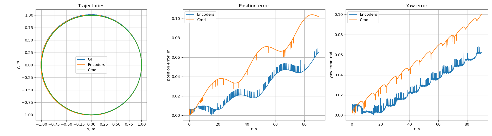
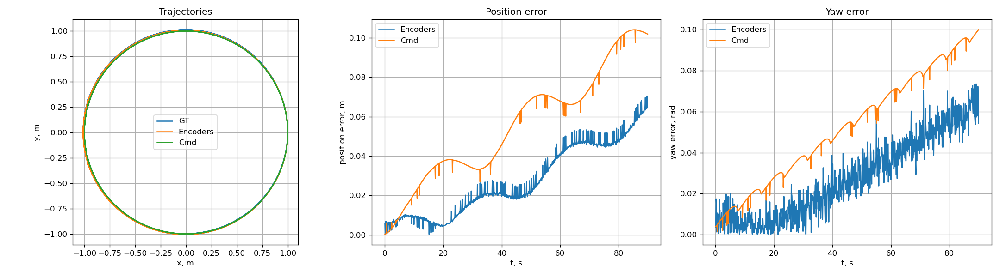
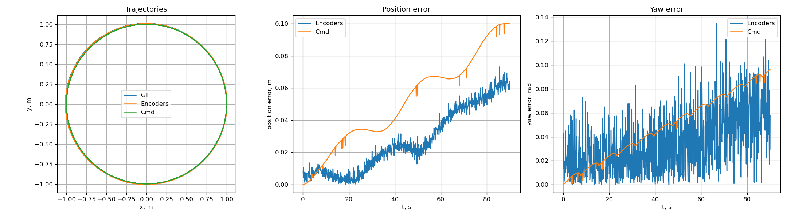

# Результат выполнения практической работы 3    

Для выполнения задания был создан пакет practice2 для запуска TurtleBot3 в Webots. В центре сцены размещены два препятствия в форме цифр номера варианта 08. Робот движется по окружности вокруг обеих цифр.

## Сборка 

1. Зайти в папку проекта 

2. Запустить контейнер
```bash
HOST_XAUTHORITY="$XAUTHORITY" docker compose --env-file .env --env-file .env.local -f docker-compose.yaml -f docker-compose.gpu.yaml -f docker-compose.webots-mac.yaml up -d
```

3. Запустить в нем zsh
```bash
HOST_XAUTHORITY="$XAUTHORITY" docker compose --env-file .env --env-file .env.local -f docker-compose.yaml -f docker-compose.gpu.yaml -f docker-compose.webots-mac.yaml exec -it ros2-base zsh
```

4. Собрать рабочее пространство 
```bash
cd ~/practices_ws
colcon build --symlink-install
source install/setup.zsh
```

## Запуск симулятора и робота

Запустить launch файл
```
ros2 launch practice03 spawn_robot.launch.py duration:=90.0
```

Запустится симулятор со сценой, на которой робот будет ехать по кругу и считать одометрию. 

## Анализ результата

Проведены три запуска с разным уровнем шума энкодеров `encoderNoise`: `0`, `0.02` и `0.1` рад. Параметры движения и длительность одинаковы.

**Без шума `encoderNoise = 0`**


Даже при encoderNoise 0 одометрия по энкодерам не совпадает с GT идеально. Причина — контакт колёс с поверхностью, проскальзывание, квантование и параметры кинематической модели. 
На графике ошибки угла значения, расчитанные по энкодерам скачут из-за дискретности датчика. Значения рассчитаные по командам выстраиваются в более гладкую линию, но накапливается систематическая ошибка, так как не учитывается реальная динамика робота.

**Шум `encoderNoise = 0.02`**


С добавлением шума ошибка угла рысканья для энкодеров выросла и стала более «рваной»: каждое измерение угла колеса искажается, и ошибки накапливаются. Ошибка положения также увеличилась. Оценка по командам осталась гладкой и практически
не изменилась, тк она не зависит от показаний энкодеров.

**Шум `encoderNoise = 0.1`**


При сильном шуме одометрия по энкодерам сильно отклоняется от GT и становится очень шумной, ошибка положения также растёт.
Оценка по командам сохраняет гладкость и тот же уровень систематической ошибки, что и в предыдущих запусках.

**ИТОГ**
Сравнение трёх графиков показывает, что оценка по командам не зависит от уровня шума энкодеров (оранжевая линия на всех трёх картинках одинаковая), тогда как ошибка по энкодерам увеличивается с ростом шума. Это подтверждает, что два источника одометрии имеют разную природу ошибок: систематическую (команды) и случайную (энкодеры).

## Видео выполнения

Видео выполнения можно посмотреть по ссылке:

[https://disk.360.yandex.ru/d/GaD0L8o0LhgQuA](https://disk.360.yandex.ru/d/GaD0L8o0LhgQuA)