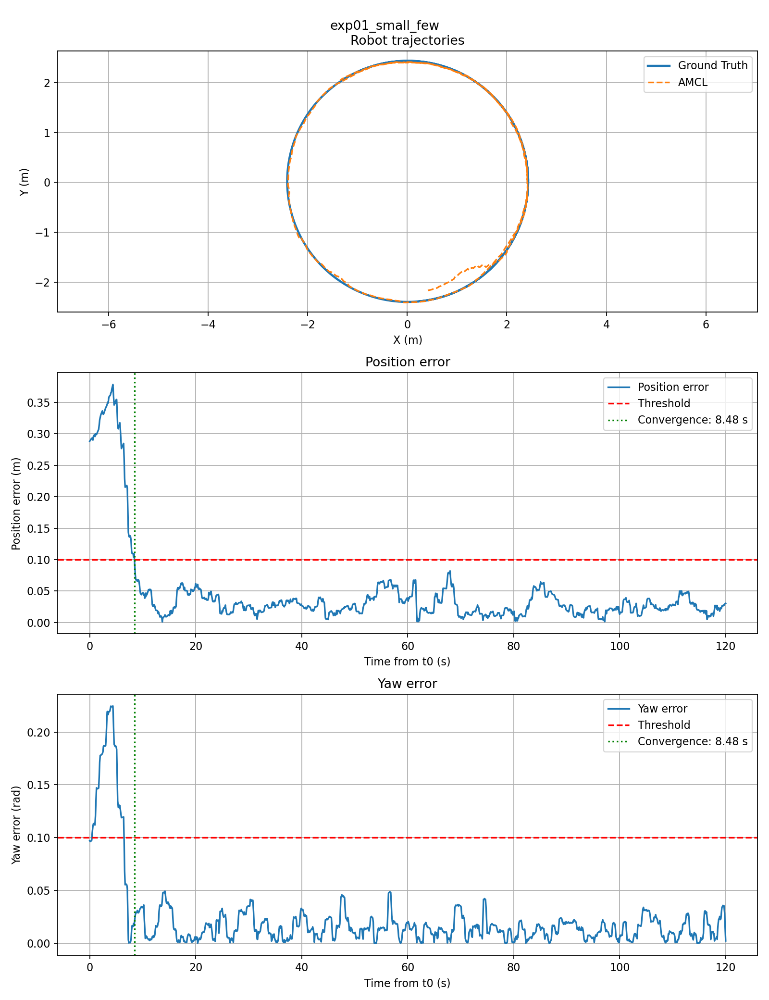
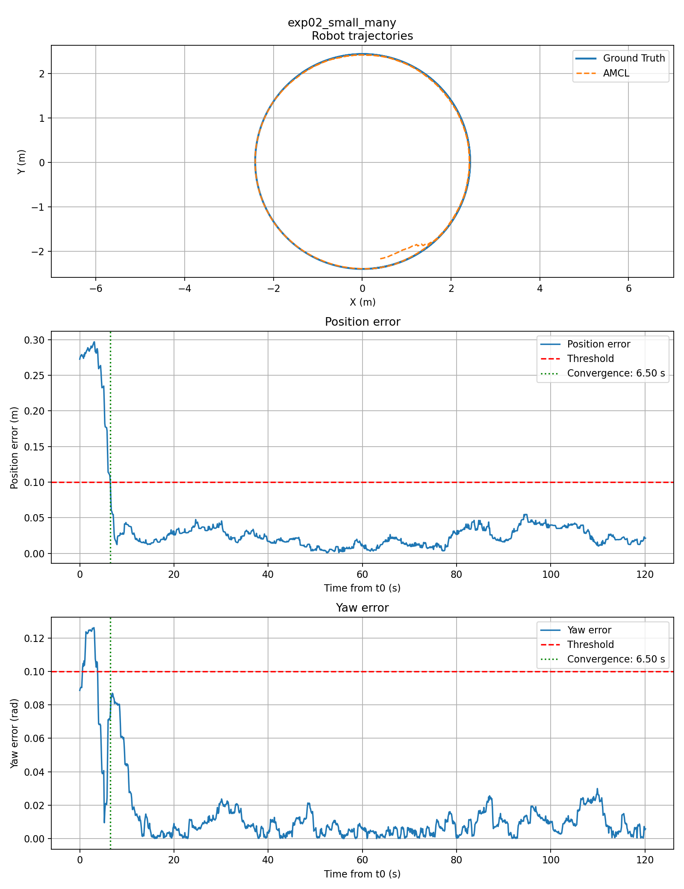
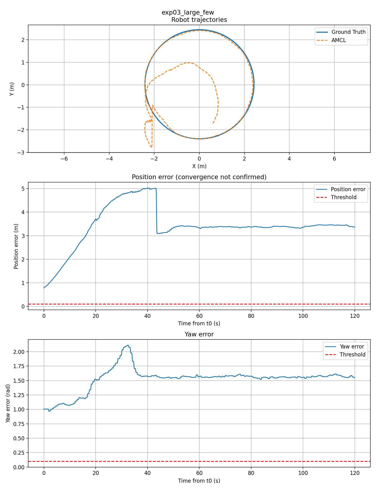
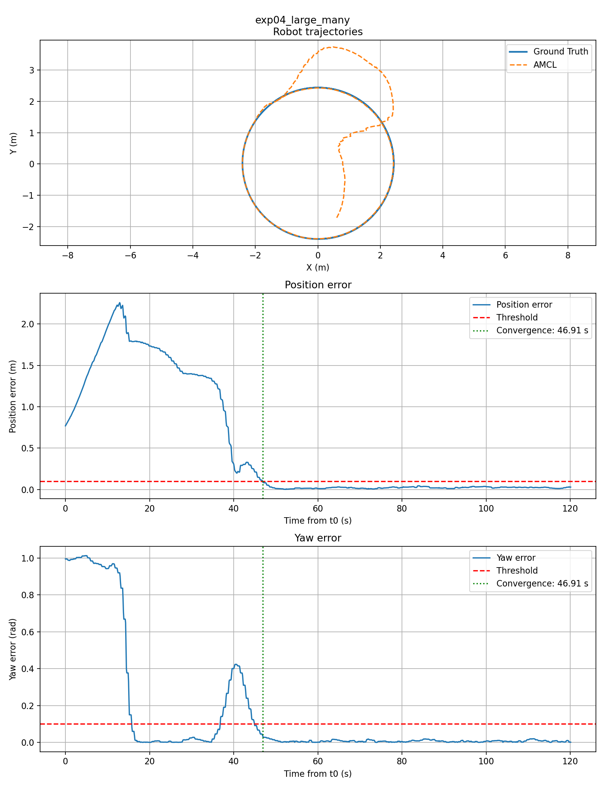
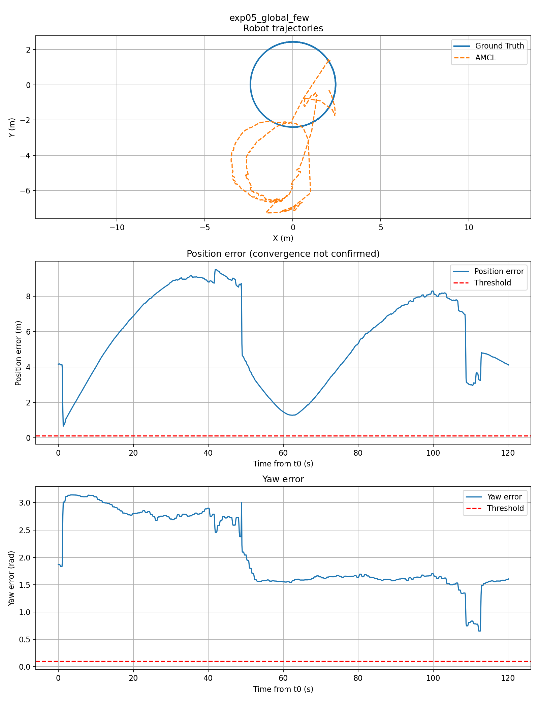
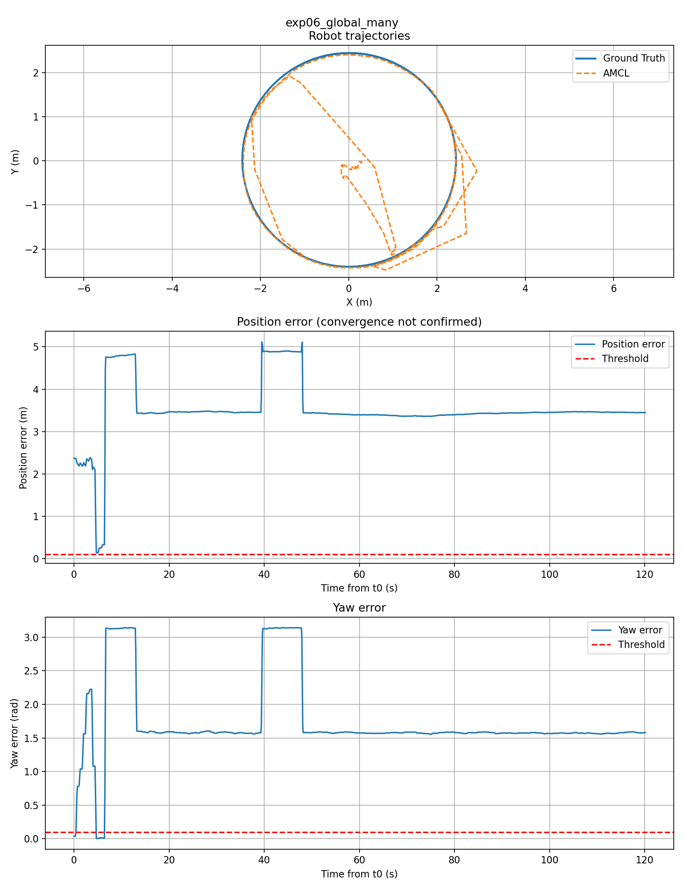

# Результат выполнения практической работы 4  

Для выполнения задания был создан пакет practice04 для запуска TurtleBot3 в Webots

## Сборка 

1. Зайти в папку проекта 

2. Запустить контейнер
```bash
HOST_XAUTHORITY="$XAUTHORITY" docker compose --env-file .env --env-file .env.local -f docker-compose.yaml -f docker-compose.gpu.yaml -f docker-compose.webots-mac.yaml up -d
```

3. Запустить в нем zsh
```bash
HOST_XAUTHORITY="$XAUTHORITY" docker compose --env-file .env --env-file .env.local -f docker-compose.yaml -f docker-compose.gpu.yaml -f docker-compose.webots-mac.yaml exec -it ros2-base zsh
```

4. Собрать рабочее пространство 
```bash
cd ~/practices_ws
colcon build --symlink-install
source install/setup.zsh
```

## Запуск симулятора и робота

Перед каждым экспериментом в файле `config/amcl.yaml` устанавить параметры количества частиц:

**Малое количество частиц (эксперименты №1, №3, №5):**

```yaml
min_particles: 100
max_particles: 500
```

**Большое количество частиц (эксперименты №2, №4, №6):**

```yaml
min_particles: 1000
max_particles: 15000
```

После изменения конфигурации пересобрать пакет:

```zsh
cd ~/practices_ws
colcon build --packages-select practice04
source install/local_setup.zsh
```

### Эксперимент №1 — малая начальная ошибка, мало частиц

```zsh
ros2 launch practice04 spawn_robot.launch.py \
  localization_mode:=initial \
  error_x:=0.2 \
  error_y:=0.2 \
  error_yaw:=0.1 \
  duration:=120.0 \
  run_name:=exp01_small_few
```

### Эксперимент №2 — малая начальная ошибка, много частиц

```zsh
ros2 launch practice04 spawn_robot.launch.py \
  localization_mode:=initial \
  error_x:=0.2 \
  error_y:=0.2 \
  error_yaw:=0.1 \
  duration:=120.0 \
  run_name:=exp02_small_many
```

### Эксперимент №3 — большая начальная ошибка, мало частиц

```zsh
ros2 launch practice04 spawn_robot.launch.py \
  localization_mode:=initial \
  error_x:=0.5 \
  error_y:=0.5 \
  error_yaw:=1.0 \
  duration:=120.0 \
  run_name:=exp03_large_few
```

### Эксперимент №4 — большая начальная ошибка, много частиц

```zsh
ros2 launch practice04 spawn_robot.launch.py \
  localization_mode:=initial \
  error_x:=0.5 \
  error_y:=0.5 \
  error_yaw:=1.0 \
  duration:=120.0 \
  run_name:=exp04_large_many
```

### Эксперимент №5 — глобальная локализация, мало частиц

```zsh
ros2 launch practice04 spawn_robot.launch.py \
  localization_mode:=global \
  duration:=120.0 \
  run_name:=exp05_global_few
```

### Эксперимент №6 — глобальная локализация, много частиц

```zsh
ros2 launch practice04 spawn_robot.launch.py \
  localization_mode:=global \
  duration:=120.0 \
  run_name:=exp06_global_many
```

Каждый эксперимент выполнялся в течение **120 секунд симуляционного времени**.

После завершения измерений результаты автоматически сохранялись в папку `results/`.

Во всех экспериментах использовались одинаковые критерии сходимости: ошибка положения меньше **0.10 м** и ошибка ориентации меньше **0.10 рад** непрерывно в течение **10 секунд**.

## Анализ результата

### 1. Методика оценки локализации

Для исследования работы алгоритма AMCL было проведено шесть экспериментов с различными начальными условиями и количеством частиц.

В каждом эксперименте робот TurtleBot3 Burger двигался по круговой траектории в симуляторе Webots. Оценка положения, полученная с помощью AMCL, сравнивалась с истинным положением робота (Ground Truth).

Истинное положение публиковалось через TF-преобразование `map → base_link_gt`, а оценённое положение определялось через `map → base_link`.

Для каждого измерения вычислялись две ошибки.

Для оценки времени сходимости использовались следующие параметры:

| Параметр | Значение |
|---|---:|
| Длительность эксперимента | 120 с |
| Порог ошибки положения | 0.10 м |
| Порог ошибки ориентации | 0.10 рад |
| Время подтверждения сходимости | 10 с |
| Период измерений | 0.1 с |

Сходимость считалась подтверждённой, если обе ошибки одновременно оставались ниже соответствующих порогов в течение 10 секунд подряд.

Временем сходимости считалось начало первого интервала, на котором эти условия были выполнены.

Если за 120 секунд такой интервал не был найден, результат обозначался как «Не сошёлся за 120 с».

### 2. Условия экспериментов

Исследовались три режима инициализации AMCL:

1. **Малая начальная ошибка:** `error_x = 0.2 м`, `error_y = 0.2 м`, `error_yaw = 0.1 рад`.
2. **Большая начальная ошибка:** `error_x = 0.5 м`, `error_y = 0.5 м`, `error_yaw = 1.0 рад`.
3. **Глобальная локализация:** поиск положения робота без заранее заданной начальной оценки.

Каждый режим проверялся с двумя наборами параметров фильтра частиц:

| Режим | `min_particles` | `max_particles` |
|---|---:|---:|
| Малое количество частиц | 100 | 500 |
| Большое количество частиц | 1000 | 15000 |

Таким образом, всего было проведено шесть экспериментов.

### 3. Сводная таблица результатов

| № | Режим инициализации | `max_particles` | Время сходимости | Результат |
|---|---|---:|---:|---|
| 1 | Малая ошибка | 500 | 8.48 с | Сошёлся |
| 2 | Малая ошибка | 15000 | 6.5 с | Сошёлся |
| 3 | Большая ошибка | 500 | — | Не сошёлся за 120 с |
| 4 | Большая ошибка | 15000 | 46.91 с | Сошёлся |
| 5 | Глобальная локализация | 500 | — | Не сошёлся за 120 с |
| 6 | Глобальная локализация | 15000 | — | Не сошёлся за 120 с |

В трёх из шести экспериментов была подтверждена сходимость алгоритма AMCL.

---

### 4. Эксперимент №1 — малая начальная ошибка, мало частиц

**Параметры:**
- `localization_mode = initial`;
- `error_x = 0.2`, `error_y = 0.2`, `error_yaw = 0.1`;
- `min_particles = 100`, `max_particles = 500`.

**Время сходимости: 22.40 с.**



На первом графике представлены истинная траектория робота и траектория, восстановленная алгоритмом AMCL. После начального переходного процесса они практически совпадают.

На втором графике показана ошибка положения. В начале эксперимента она превышает заданный порог 0.10 м, затем уменьшается.

Третий график демонстрирует изменение ошибки ориентации. После уточнения положения эта ошибка остаётся небольшой.

**Вывод:** при небольшой начальной ошибке AMCL смог успешно локализовать робота даже с ограниченным количеством частиц. Подтверждённая сходимость наступила через 22.40 секунды.

### 5. Эксперимент №2 — малая начальная ошибка, много частиц

**Параметры:**
- `localization_mode = initial`;
- `error_x = 0.2`, `error_y = 0.2`, `error_yaw = 0.1`;
- `min_particles = 1000`, `max_particles = 15000`.

**Время сходимости: 16.48 с.**



На графике траекторий видно, что оценка AMCL после начального переходного процесса практически совпадает с истинным движением робота.

Ошибка положения постепенно уменьшается и достигает установленного порога раньше, чем в эксперименте №1.

Ошибка ориентации также снижается и после сходимости остаётся небольшой.

**Вывод:** при большом количестве частиц алгоритм успешно локализовался за 16.48 секунды. Это быстрее результата эксперимента №1.

### 6. Сравнение экспериментов №1 и №2

В обоих экспериментах использовалась одинаковая малая начальная ошибка. Изменялось только количество частиц.

| Показатель | №1 — мало частиц | №2 — много частиц |
|---|---:|---:|
| `max_particles` | 500 | 15000 |
| Время сходимости | 22.40 с | 16.48 с |
| Подтверждённая сходимость | Да | Да |

Разница времени сходимости:

$
22.40-16.48=5.92\text{ с}
$

В данном сравнении увеличение допустимого количества частиц сократило время сходимости на **5.92 секунды**, или приблизительно на **26.4%**.

При этом оба режима успешно справились с небольшой начальной ошибкой.

---

### 7. Эксперимент №3 — большая начальная ошибка, мало частиц

**Параметры:**
- `localization_mode = initial`;
- `error_x = 0.5`, `error_y = 0.5`, `error_yaw = 1.0`;
- `min_particles = 100`, `max_particles = 500`.

**Результат: сходимость не подтверждена за 120 секунд.**



На графике траекторий наблюдается значительное расхождение между истинным положением робота и оценкой AMCL.

Вместо движения по правильной круговой траектории оценка AMCL отклоняется в сторону другой области карты.

Ошибка положения увеличивается примерно до 3.4 м и затем остаётся на высоком уровне.

Ошибка ориентации достигает приблизительно 1.55 рад. Обе ошибки существенно превышают установленные пороги.

**Вывод:** при большой начальной ошибке и малом количестве частиц AMCL не смог восстановить правильное положение робота за 120 секунд. Вероятно, фильтр закрепился на неправильной гипотезе положения.

### 8. Эксперимент №4 — большая начальная ошибка, много частиц

**Параметры:**
- `localization_mode = initial`;
- `error_x = 0.5`, `error_y = 0.5`, `error_yaw = 1.0`;
- `min_particles = 1000`, `max_particles = 15000`.

**Время сходимости: 39.01 с.**



В начале эксперимента между траекториями Ground Truth и AMCL наблюдается заметное расхождение.

Ошибка положения первоначально достигает приблизительно 2 м. По мере движения робота и поступления новых измерений LiDAR она уменьшается.

Ошибка ориентации также постепенно снижается.

Через 39.01 секунды подтверждается сходимость. После этого оценённая траектория практически совпадает с истинной.

**Вывод:** увеличение допустимого количества частиц позволило AMCL успешно скорректировать большую начальную ошибку.

### 9. Сравнение экспериментов №3 и №4

Эксперименты проводились при одинаковой большой начальной ошибке.

| Показатель | №3 — мало частиц | №4 — много частиц |
|---|---|---|
| `max_particles` | 500 | 15000 |
| Время сходимости | Не сошёлся за 120 с | 39.01 с |
| Ошибка положения к концу | Около 3.4 м | Небольшая |
| Подтверждённая сходимость | Нет | Да |

При малом количестве частиц алгоритм не смог определить правильное положение за время эксперимента.

При большом количестве частиц AMCL смог исправить ошибочную начальную оценку и достичь требуемой точности.

**Следовательно, в данном испытании увеличение числа частиц существенно повысило устойчивость локализации к большой начальной ошибке.**

---

### 10. Эксперимент №5 — глобальная локализация, мало частиц

**Параметры:**
- `localization_mode = global`;
- `min_particles = 100`, `max_particles = 500`;
- начальная поза не задавалась.

**Результат: сходимость не подтверждена за 120 секунд.**



Оценённая траектория AMCL заметно отличалась от Ground Truth и в отдельные моменты проходила далеко за пределами истинной круговой траектории. Ошибка положения существенно менялась: поднималась примерно до 9 м, временно снижалась приблизительно до 1.2 м, но так и не достигала порога 0.10 м. Ошибка ориентации также оставалась высокой, местами приближаясь к 3.1 рад.

Вывод: глобальная локализация с малым количеством частиц не сошлась за 120 с. В этом запуске оценка положения была нестабильной.

### 11. Эксперимент №6 — глобальная локализация, много частиц

**Параметры:**
- `localization_mode = global`;
- `min_particles = 1000`, `max_particles = 15000`;
- начальная поза не задавалась.

**Результат: сходимость не подтверждена за 120 секунд.**



В начале эксперимента оценка AMCL резко менялась. Ошибка положения на отдельных участках достигала примерно 5 м, а ошибка ориентации — около 3.1 рад. После переходных процессов ошибка положения оставалась около 3.4–3.5 м, а ошибка ориентации — около 1.55–1.6 рад. Требуемые пороги не были достигнуты на подтверждённом интервале.

Вывод: увеличение числа частиц не привело к успешной глобальной локализации за 120 с.

### 12. Сравнение экспериментов №5 и №6

| Показатель | №5 — мало частиц | №6 — много частиц |
|---|---|---|
| Режим | Глобальный | Глобальный |
| `max_particles` | 500 | 15000 |
| Время сходимости | Не сошёлся за 120 с | Не сошёлся за 120 с |
| Подтверждённая сходимость | Нет | Нет |

В обоих экспериментах алгоритм не смог самостоятельно определить правильное положение робота.

Возможные причины:

- недостаточная различимость участков карты по данным LiDAR;
- наличие нескольких похожих гипотез положения;
- закрепление фильтра на неправильной гипотезе;
- особенности выбранных параметров AMCL.

Увеличение количества частиц само по себе не устранило проблему.

По полученным графикам нельзя однозначно установить причину отсутствия сходимости.

---

### 13. Общий анализ результатов

По результатам шести экспериментов можно выделить три основных наблюдения.

**1. Влияние начальной ошибки**

При небольшой начальной ошибке локализация была успешной в обоих режимах количества частиц.

При большой начальной ошибке алгоритм успешно сошёлся только в режиме с большим количеством частиц.

Это показывает, что увеличение начальной неопределённости усложняет задачу локализации.

**2. Влияние количества частиц**

Увеличение допустимого количества частиц улучшило результаты при известной начальной оценке положения:

- при малой ошибке время сходимости уменьшилось с 22.40 до 16.48 с;
- при большой ошибке сходимость была получена только в режиме с большим количеством частиц.

Однако в режиме глобальной локализации увеличение количества частиц не привело к подтверждённой сходимости за 120 секунд.

**3. Сложность глобальной локализации**

Глобальная локализация оказалась наиболее сложным режимом в проведённых испытаниях.

При отсутствии начальной оценки AMCL должен самостоятельно выбрать правильную гипотезу положения по данным карты, одометрии и LiDAR.

В обоих глобальных экспериментах правильная оценка не была восстановлена за время наблюдения.

### 14. Итоговые выводы

В ходе практической работы исследовано влияние начальной ошибки и количества частиц на точность и скорость локализации AMCL.

По результатам экспериментов установлено:

1. При малой начальной ошибке AMCL успешно локализовался в обоих режимах количества частиц.
2. Наименьшее время сходимости — **16.48 с** — получено при малой начальной ошибке и большом количестве частиц.
3. При большой начальной ошибке малое количество частиц не обеспечило сходимость за 120 с.
4. Увеличение количества частиц при большой начальной ошибке позволило добиться сходимости за **39.01 с**.
5. При глобальной инициализации сходимость не была подтверждена ни при малом, ни при большом количестве частиц.
6. Увеличение числа частиц может улучшать локализацию, но не гарантирует успешную сходимость при любых начальных условиях.

**Основной вывод:** алгоритм AMCL наиболее успешно работал при наличии достаточно точной начальной оценки положения. При значительной начальной неопределённости увеличение числа частиц помогало сохранить правильную гипотезу локализации, однако при глобальной инициализации этого оказалось недостаточно в пределах 120 секунд.


## Видео выполнения

Видео выполнения можно посмотреть по ссылке:

[https://disk.360.yandex.ru/d/NnbE8uQT-ArROg](https://disk.360.yandex.ru/d/NnbE8uQT-ArROg)
[https://drive.google.com/file/d/1QUg3PgUehHKc8yJg6m6ct4o6jb5zsZqn/view?usp=share_link](https://drive.google.com/file/d/1QUg3PgUehHKc8yJg6m6ct4o6jb5zsZqn/view?usp=share_link)